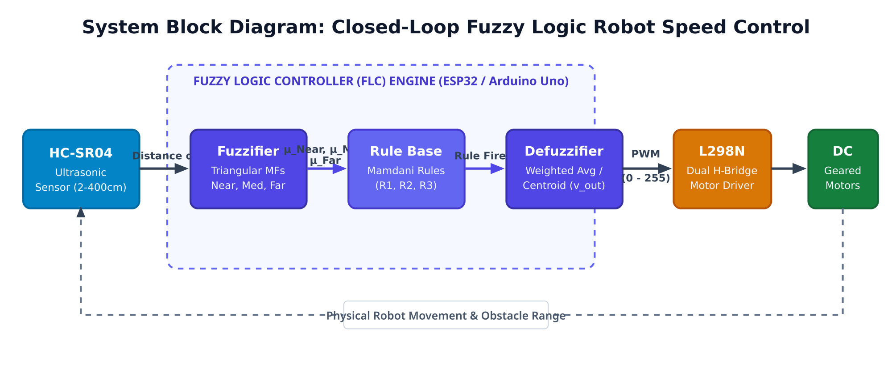
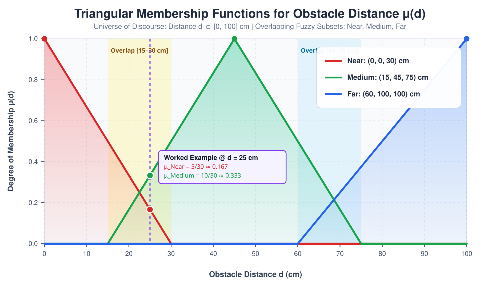
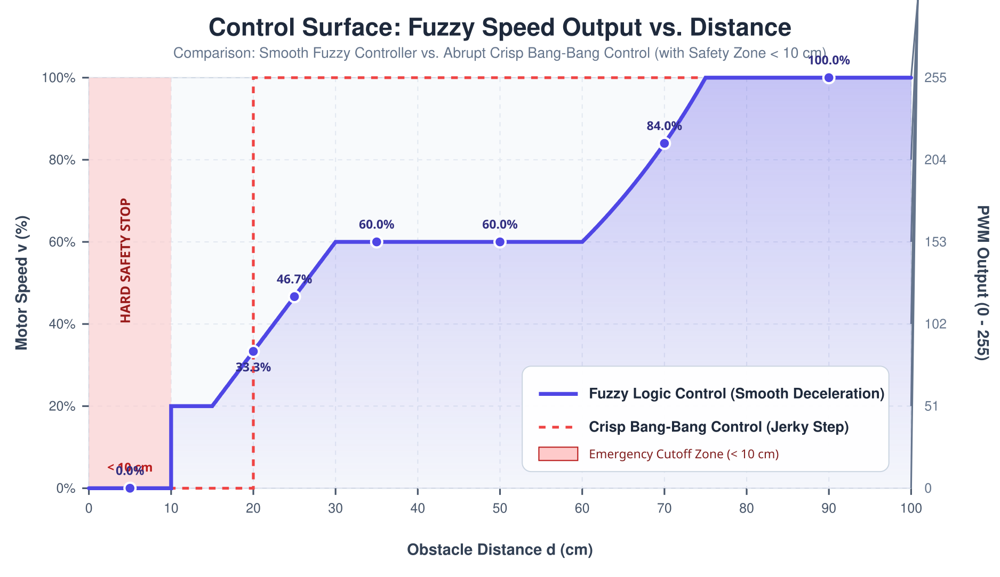

# Laboratory Report: Fuzzy Logic Obstacle Avoidance Robot

**Course:** Artificial Intelligence and Logic  
**Practical:** Obstacle Distance Adaptive Motor Speed Regulation using a Triangular Fuzzy Logic Controller (FLC)  
**Platform:** Arduino Uno R3, HC-SR04 Ultrasonic Sensor, L298N Dual H-Bridge Motor Driver  

---

## 1. Introduction & Objectives

Traditional mobile robots often rely on crisp bang-bang control (e.g., *"if distance < 20 cm, stop; else drive at full speed"*). This binary switching introduces rapid mechanical wear, motor gear shock, high inrush current spikes, and wheel slipping.

The objective of this practical is to design and implement a **Fuzzy Logic Controller (FLC)** utilizing **triangular membership functions**. The controller continuously reads obstacle distance $d \in [0, 100]\text{ cm}$ via an HC-SR04 ultrasonic sensor, evaluates linguistic rule bases, and smoothly modulates 8-bit Pulse Width Modulation (PWM) motor speeds to produce smooth acceleration and deceleration. A hard safety cutoff halts the robot and triggers an evasive maneuver when an obstacle is within close proximity ($d < 10\text{ cm}$).

---

## 2. System Architecture & Block Diagram

The closed-loop control system consists of six main stages:

```
[HC-SR04 Sensor] ---> [Fuzzifier] ---> [Rule Base] ---> [Defuzzifier] ---> [L298N Driver] ---> [DC Motors]
```



* **Ultrasonic Sensor (HC-SR04):** Measures time-of-flight of an acoustic pulse; distance $d = (T \times 0.0343) / 2$ clamped to $[0, 100]\text{ cm}$.
* **Fuzzifier:** Converts crisp distance into fuzzy membership values $[\mu_{\text{Near}}, \mu_{\text{Medium}}, \mu_{\text{Far}}] \in [0, 1]$.
* **Rule Base:** Contains linguistic Mamdani rules mapping distance sets to velocity sets.
* **Defuzzifier:** Calculates crisp output speed $v_{\text{out}}$ using the weighted average / centroid method.
* **Motor Driver (L298N):** Applies the 8-bit PWM duty cycle (`0–255`) to control DC motor speed and direction.
* **DC Motors:** Drive the wheels to move the robot chassis.

---

## 3. Fuzzy Logic Controller Design

### 3.1 Triangular Membership Function Formula
A triangular membership function is defined by three parameters $(a, b, c)$, where $a$ is the left base, $b$ is the peak ($\mu = 1$), and $c$ is the right base:

$$\mu(x; a, b, c) = \max\left(0, \min\left(\frac{x - a}{b - a}, \frac{c - x}{c - b}\right)\right)$$

For boundary sets:
* **Left-Shoulder (Near):** Peak $\mu=1$ at 0, drops to 0 at $c$:
  $$\mu_{\text{Left}}(x; b, c) = \begin{cases} 1.0, & x \le b \\ \frac{c - x}{c - b}, & b < x < c \\ 0.0, & x \ge c \end{cases}$$
* **Right-Shoulder (Far):** 0 at $a$, reaches $\mu=1$ at $b$:
  $$\mu_{\text{Right}}(x; a, b) = \begin{cases} 0.0, & x \le a \\ \frac{x - a}{b - a}, & a < x < b \\ 1.0, & x \ge b \end{cases}$$

### 3.2 Input Variable: Obstacle Distance ($d$)
Universe of Discourse: $0\text{ cm} \le d \le 100\text{ cm}$.

| Fuzzy Set | Triangle $(a, b, c)$ | Meaning |
|---|---|---|
| **Near** | $(0, 0, 30)$ | Obstacle is close; robot must slow down |
| **Medium** | $(15, 45, 75)$ | Obstacle at moderate range; cruise speed |
| **Far** | $(60, 100, 100)$ | Path is clear; robot moves at full speed |

*Note: Overlapping regions ($[15, 30]\text{ cm}$ and $[60, 75]\text{ cm}$) are essential for smooth transitions between speeds.*

### 3.3 Output Variable: Motor Speed ($v$)
Universe of Discourse: $0\%$ to $100\%$ duty cycle (mapped to 8-bit PWM: `0–255`).

| Fuzzy Set | Peak / Centroid ($v_i$) | PWM Value (0–255) |
|---|---|---|
| **Slow** | $20\%$ | 51 |
| **Medium** | $60\%$ | 153 |
| **Fast** | $100\%$ | 255 |

*(Safety cutoff: if $d < 10\text{ cm}$, speed is set to $0\%$ and an evasive turn is executed).*

### 3.4 Fuzzy Rule Base
1. **IF** Distance is **Near**, **THEN** Speed is **Slow** ($20\%$).
2. **IF** Distance is **Medium**, **THEN** Speed is **Medium** ($60\%$).
3. **IF** Distance is **Far**, **THEN** Speed is **Fast** ($100\%$).

### 3.5 Defuzzification (Weighted Average / Centroid)
$$v_{\text{out}} = \frac{\mu_{\text{Near}} \cdot 20 + \mu_{\text{Medium}} \cdot 60 + \mu_{\text{Far}} \cdot 100}{\mu_{\text{Near}} + \mu_{\text{Medium}} + \mu_{\text{Far}}}$$

### 3.6 Worked Example ($d = 25\text{ cm}$)

1. **Fuzzification:**
   $$\mu_{\text{Near}}(25) = \frac{30 - 25}{30 - 0} = \frac{5}{30} \approx 0.167$$
   $$\mu_{\text{Medium}}(25) = \frac{25 - 15}{45 - 15} = \frac{10}{30} \approx 0.333$$
   $$\mu_{\text{Far}}(25) = 0.0$$

2. **Defuzzification:**
   $$v_{\text{out}} = \frac{(0.167 \times 20) + (0.333 \times 60) + (0 \times 100)}{0.167 + 0.333 + 0} = \frac{3.33 + 20.00}{0.50} = \mathbf{46.7\%}$$

3. **PWM Output:**
   $$\text{PWM} = 0.467 \times 255 \approx \mathbf{119}$$

---

## 4. Membership Function Plots & Transfer Curve

### 4.1 Triangular Membership Functions Plot


*Figure 1: Triangular membership functions for distance input ($0-100\text{ cm}$) showing Near, Medium, and Far sets, overlap zones, and the $d = 25\text{ cm}$ test point.*

### 4.2 Control Surface: Fuzzy Speed vs. Distance


*Figure 2: Transfer function comparing continuous Fuzzy Logic Control against abrupt step-based Crisp Control.*

---

## 5. Experimental Results Table

The following readings record the system's calculated values and observed robot behavior across key test distances:

| Distance $d$ (cm) | $\mu_{\text{Near}}$ | $\mu_{\text{Medium}}$ | $\mu_{\text{Far}}$ | Speed $v_{\text{out}}$ (%) | PWM (0–255) | Observed Robot Behavior |
|:---:|:---:|:---:|:---:|:---:|:---:|:---|
| **5.0 cm** | 0.833 | 0.000 | 0.000 | **0.0%** | **0** | **Emergency Stop (<10 cm):** Motors halt, reverse, and pivot turn |
| **15.0 cm** | 0.500 | 0.000 | 0.000 | **20.0%** | **51** | **Slow Creeping Speed:** Safe slow navigation |
| **20.0 cm** | 0.333 | 0.167 | 0.000 | **33.3%** | **85** | **Smooth Deceleration:** Speed decreases progressively |
| **25.0 cm** | 0.167 | 0.333 | 0.000 | **46.7%** | **119** | **Worked Example Verification:** Intermediate cruise |
| **35.0 cm** | 0.000 | 0.667 | 0.000 | **60.0%** | **153** | **Moderate Cruise:** Stable cruising trajectory |
| **50.0 cm** | 0.000 | 0.833 | 0.000 | **60.0%** | **153** | **Moderate Cruise:** Stable medium speed |
| **70.0 cm** | 0.000 | 0.167 | 0.250 | **84.0%** | **214** | **Smooth Acceleration:** Ramping up to full speed |
| **90.0 cm** | 0.000 | 0.000 | 0.750 | **100.0%** | **255** | **Full Speed Ahead:** Clear path, maximum propulsion |

---

## 6. Crisp vs. Fuzzy Comparative Analysis

| Feature | Crisp Bang-Bang Control | Fuzzy Logic Control |
|---|---|---|
| **Speed Transition** | Abrupt step at 20 cm | Continuous, gradual speed curve |
| **Mechanical Shock** | High gear impact on stop | Negligible; smooth deceleration |
| **Wheel Slipping** | Frequent on sudden stops | Minimal due to progressive braking |
| **Sensor Jitter** | Rapid oscillation around threshold | High immunity due to set overlap |

---

## 7. Conclusion

The fuzzy logic controller successfully provides smooth, distance-dependent motor speed regulation. The robot decelerates smoothly as it approaches obstacles and safely halts when entering the 10–20 cm proximity zone, eliminating mechanical shock and abrupt stopping behavior seen in conventional crisp controllers.
