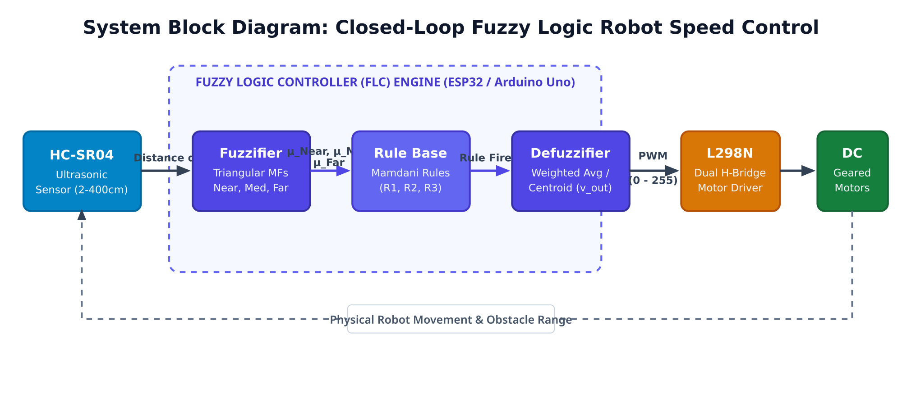

# System Architecture & Block Diagram

## 1. System Block Diagram

---

## 2. High-Resolution Architectural Diagram

---

## 3. Data Transformation Pipeline

The Fuzzy Logic Speed Controller operates sequentially through six discrete stages every 100 milliseconds:

### Stage 1: Sensing & Signal Acquisition
- A 10 µs HIGH trigger pulse is sent from the MCU to the `TRIG` pin of the HC-SR04.
- An 8-cycle sonic burst (40 kHz) travels through air at $v_{\text{sound}} \approx 343\text{ m/s}$ ($0.0343\text{ cm/\mu s}$).
- The MCU measures the echo pulse duration $T_{\text{pulse}}$ in microseconds:
  $$d_{\text{raw}} = \frac{T_{\text{pulse}} \times 0.0343}{2}$$
- Any reading $> 100\text{ cm}$ or timeout is clamped to the upper boundary $d = 100.0\text{ cm}$.

### Stage 2: Critical Safety Evaluation
- If $d < 10.0\text{ cm}$, the system immediately bypasses normal fuzzy speed cruising.
- The motors are instantly halted ($\text{PWM} = 0$), followed by a brief reverse maneuver and a pivot turn to clear the dead-end obstruction.

### Stage 3: Fuzzification (Input Universe $\rightarrow$ Fuzzy Sets)
The crisp distance $d$ is mapped onto three overlapping fuzzy subsets using triangular membership equations:
1. **Near:** Left-shoulder triangle $(0, 0, 30)$ cm:
   $$\mu_{\text{Near}}(d) = \begin{cases} 1.0 & d \le 0 \\ \frac{30 - d}{30} & 0 < d < 30 \\ 0.0 & d \ge 30 \end{cases}$$
2. **Medium:** Symmetric triangle $(15, 45, 75)$ cm:
   $$\mu_{\text{Medium}}(d) = \begin{cases} 0.0 & d \le 15 \text{ or } d \ge 75 \\ \frac{d - 15}{30} & 15 < d < 45 \\ \frac{75 - d}{30} & 45 \le d < 75 \end{cases}$$
3. **Far:** Right-shoulder triangle $(60, 100, 100)$ cm:
   $$\mu_{\text{Far}}(d) = \begin{cases} 0.0 & d \le 60 \\ \frac{d - 60}{40} & 60 < d < 100 \\ 1.0 & d \ge 100 \end{cases}$$

### Stage 4: Rule Evaluation
Three linguistic IF-THEN rules determine the intended speed profile:
* **Rule 1:** IF Distance is **Near**, THEN Speed is **Slow** ($v_1 = 20\%$).
* **Rule 2:** IF Distance is **Medium**, THEN Speed is **Medium** ($v_2 = 60\%$).
* **Rule 3:** IF Distance is **Far**, THEN Speed is **Fast** ($v_3 = 100\%$).

### Stage 5: Defuzzification (Weighted Average / Centroid)
The individual rule consequences are integrated into a single continuous speed percentage:
$$v_{\text{out}} = \frac{\mu_{\text{Near}} \cdot 20 + \mu_{\text{Medium}} \cdot 60 + \mu_{\text{Far}} \cdot 100}{\mu_{\text{Near}} + \mu_{\text{Medium}} + \mu_{\text{Far}}}$$

### Stage 6: Actuation (PWM Modulation)
The continuous speed percentage $v_{\text{out}} \in [0, 100]\%$ is linearly scaled to an 8-bit timer register:
$$\text{PWM} = \left\lfloor \frac{v_{\text{out}}}{100} \times 255 \right\rceil$$
The PWM signal gates the L298N H-Bridge optocouplers, regulating the effective terminal voltage applied across the DC motors:
$$V_{\text{motor}} = V_{\text{battery}} \times \left(\frac{\text{PWM}}{255}\right)$$
